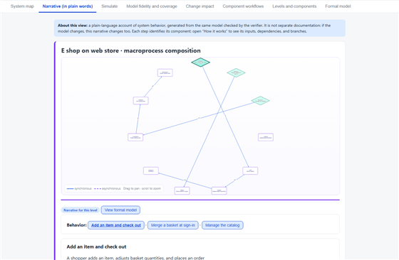
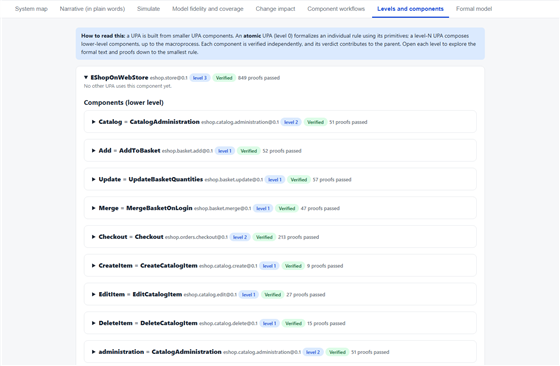

# UPA — an explicit organizational model for humans and AI

```text
                  ██╗   ██╗ ██████╗   █████╗
                  ██║   ██║ ██╔══██╗ ██╔══██╗
                  ██║   ██║ ██████╔╝ ███████║
                  ██║   ██║ ██╔═══╝  ██╔══██║
                  ╚██████╔╝ ██║      ██║  ██║
                   ╚═════╝  ╚═╝      ╚═╝  ╚═╝

              ─── AN EXPLICIT ORGANIZATIONAL MODEL ───

  PROBABILISTIC AI  ─────────────►  UPA  ─────────────►  CHECKABLE ORG RULES
```

**If AI agents increasingly build and operate software, where does the organization itself live?**

Its business rules are scattered across code, documentation, tickets, APIs, workflows, databases, and people's heads. AI can search those sources, but searching is not the same as having an explicit model of how the organization works.

UPA is an experiment in making that model explicit. It represents business rules, workflows, systems, evidence, assumptions, and unknowns in a shared machine-readable structure that humans and AI agents can inspect together. UPA can then formally check selected properties of that model with Z3, trace rules back to their evidence, explore change impact, and use the model as context for AI-assisted work.

> **UPA is not trying to replace code, documentation, or people. It is trying to make the organizational knowledge behind them explicit.** Think of it as an experiment towards a machine-readable organizational brain.

**See it first:** [open the eShopOnWeb viewer](https://julianfromano.github.io/upa-organization-brain/#narrative) · [build and verify a checkout model](#quick-start) · [read how the UPA skill works](skills/upa-generate/SKILL.md).

| [](https://julianfromano.github.io/upa-organization-brain/#narrative) | [](https://julianfromano.github.io/upa-organization-brain/#levels) |
| :---: | :---: |
| *The customer journey as connected behavior. [Open the narrative](https://julianfromano.github.io/upa-organization-brain/#narrative).* | *Explore reusable components, down to individual behaviors and rules. [Open the hierarchy](https://julianfromano.github.io/upa-organization-brain/#levels).* |

Unlike a document dump or a chatbot trained on disconnected prose, a UPA model connects workflows, reusable rules, systems, evidence, and assumptions in one traceable structure. People and AI can inspect the same context, check modeled rules, and use its machine-readable artifacts in viewers, generators, and tests—while people remain responsible for validating evidence and approving changes.

## A tiny example

What happens when a customer signs in with an anonymous basket already in progress—what happens to it? The answer is usually implicit in several places at once:

```text
application code · documentation · database constraints · API behavior · product decisions
```

UPA turns that distributed knowledge into something explicit. The sketch below is **conceptual**, not UPA syntax:

```text
RULE:          on sign-in, the anonymous basket is merged into the customer's basket

EVIDENCE:      BasketService.cs:<line>

ASSUMPTION:    a customer has at most one saved basket

GAP:           behavior under concurrent basket updates is unknown

VERIFICATION:  after sign-in, no modeled state keeps both baskets active
```

Now a person, an AI agent, and a formal solver are reasoning about the **same rule**—and each can see what is evidenced, what is assumed, and what is still unknown.

## What VERIFIED means

> **UPA can prove properties of a model. It cannot prove that the model is reality.**

UPA verifies properties of the model under its declared assumptions. It does not prove that the model is complete, that the evidence is correct, or that a production system behaves exactly as described. Treat verification as a strong consistency check—not as a substitute for domain review, source validation, or operational testing.

### No invented certainty

UPA distinguishes between what is evidenced, assumed, inferred, verified, refuted, and unknown. Evidence, assumptions, and gaps remain first-class parts of the model, and **`UNKNOWN` is never reported as success.**

## Quick start

From a checkout of this repository, run these commands in its root. Requirements: Python 3.11 or later and `z3-solver`; `pytest` is only needed for the test suite. The optional C# generation/build steps require the .NET SDK.

```powershell
python -m pip install z3-solver

# Build and verify the bundled eShopOnWeb checkout model without writing into the example.
python -m upa build examples\eshoponweb\rules\eshop\orders\checkout\checkout.upa `
  --scope examples\eshoponweb\informal-scope.md `
  --out build\checkout

# Expected: exit code 0 and a JSON report containing "verdict": "VERIFIED".

# Optional: generate and build C# from the verified model (.NET SDK required).
python -m upa generate `
  build\checkout\canonical-ir.json `
  --out build\checkout\generated-csharp
dotnet build build\checkout\generated-csharp

# Optional: run the project tests.
python -m pip install pytest
python -m pytest tests
```

Open `build\checkout\viewer.html` to inspect the model and its evidence, or `build\checkout\verification-result.json` for the formal results. The same viewer for the full store is [hosted online](https://julianfromano.github.io/upa-organization-brain/).

The only bundled business example is [eShopOnWeb](examples/eshoponweb/README.md), an English UPA model of the MIT-licensed reference storefront. Its [macroprocess viewer](https://julianfromano.github.io/upa-organization-brain/) includes the component map and drill-down narrative. The example README documents how to rebuild all components, inspect its limitations, and run the generated C# conformance checks. Building the bundled model uses its UPA specifications; it does not require the original eShopOnWeb source checkout.

## Why not just...?

- **...use the code?** Code describes implementation precisely, but organizational intent is often distributed across implementations, configuration, and people.
- **...use documentation plus RAG?** Retrieval can surface evidence. It does not by itself turn that evidence into an explicit, consistent, formally checkable model.
- **...use Z3 directly?** Z3 reasons over formal constraints. UPA adds the organizational semantics, evidence, assumptions, gaps, composition, and traceability around those constraints.
- **...use BPMN?** BPMN describes processes well. UPA is concerned more broadly with rules, state, evidence, assumptions, systems, and formally checkable behavior.
- **...use a knowledge graph or OWL?** Those are strong at expressing entities and relationships. UPA explores combining organizational semantics with checkable behavioral constraints.

UPA is not necessarily an alternative to these tools. It explores what happens when organizational semantics, provenance, and formal verification share one model.

## How it works: from probabilistic AI to checkable rules

AI systems are powerful at interpreting ambiguous language and proposing possibilities; organizational workflows need explicit rules, accountable boundaries, and predictable outcomes. UPA provides a traceable path between those worlds.

This deliberately small checkout rule illustrates the layers below; it is not a claim about the bundled eShopOnWeb implementation. The order total is the sum of each item's unit price multiplied by its quantity, plus a service charge equal to 10% of that subtotal.

| UPA layer | What happens and why it matters | The same checkout rule, represented here |
| --- | --- | --- |
| **Semantic model** | People state business meaning explicitly, with terms, rules, evidence, assumptions, and system boundaries. This becomes shared organizational context. | “The order total includes every item's extended price and a service charge equal to 10% of the items' subtotal.” |
| **Semantic inference** | UPA derives minimal structure from rule usage, retains provenance, and leaves unresolved ambiguity visible instead of guessing. Types can be explicitly declared and flow into inferred structure. | Identify the line-item price and quantity, the order subtotal, the service-charge rate, and the final total as concepts needed by the rule. |
| **Formal model** | The compiler translates the specification into a canonical Logical IR: a precise, machine-readable contract for state, operations, and constraints. | `subtotal = Σ(unitPrice × quantity)`; `serviceCharge = 0.10 × subtotal`; `total = subtotal + serviceCharge` |
| **Verification** | Z3 checks declared obligations under stated assumptions and returns results or counterexamples. A proof is about the model, not automatically production behavior. | Check that each order total equals the extended line-item sum plus 10% of the subtotal, for all states covered by the model. |
| **Integration and code** | UPA emits provider-neutral interaction artifacts, code for supported targets, and traces that can be compared with a reference interpreter. | Generate checkout code that calculates the subtotal, applies the service-charge rule, and compare its behavior with the reference interpreter. |

The rule is descriptive; a production currency model must define its rounding behavior explicitly.

UPA also supports composition tiers—`atom`, `subprocess`, `process`, and `macroprocess`—to organize a model from an individual behavior up to an end-to-end organizational journey. These are scopes for composing business behavior, not the semantic, inference, formal, and code layers above. Components can be reused and viewed as a hierarchy, narrative, or system map.

UPA does not make an organization deterministic or infer its team structure. It makes selected behavior explicit and checkable; organizational relationships and evidence must be supplied and reviewed.

### Extend it for your codebase

UPA has two complementary kinds of reusable components:

- **Business components** are `.upa` specifications: define a rule or capability once, verify it independently, then compose and reuse it beneath larger workflows. Add or replace lower-level components to match the boundaries and behavior of your own system.
- **Code-specific components** belong to a target/provider: map the model's abstract interactions to the components used by your stack. The React DOM example has a component catalog and local implementations; extend both when you need controls tailored to your application or design system, and implement your application's own runtime behavior. A new code target can consume UPA's IRs, but requires implementing that target—it is not inferred or generated automatically from arbitrary source code.

This separation lets the business model stay provider-neutral while implementation components evolve with the codebase. See [component composition](docs/components.md) and the [frontend extension guide](docs/inferred-frontend-extension.md).

## Organization and architecture

In Conway's-law terms, how people and teams are organized shapes how their systems are built. UPA's system maps and components make that relationship visible enough to review, but UPA does not infer team structure: organizational relationships and evidence must be supplied and reviewed.

```text
ORGANIZATIONAL STRUCTURE  <---->  SYSTEM ARCHITECTURE
```

## Why model the organization this way?

- **Make tacit knowledge explicit.** Translate policies, observed behavior, and implementation details into named rules and workflows that can be discussed and reviewed.
- **Keep claims connected to evidence.** Source-backed rules identify where they came from. Assumptions, open questions, and language gaps stay visible instead of becoming hidden certainty.
- **Find contradictions earlier.** Formal verification can expose inconsistent guarantees, unreachable conditions, missing outcomes, and counterexamples before they become production defects.
- **Reuse what is already understood.** Shared components help different teams refer to the same definition rather than maintain competing copies.
- **Connect business and technology.** System maps can relate workflows to applications, services, data stores, contracts, and external boundaries.
- **Give AI better context.** A structured model can provide an AI assistant with explicit terminology, responsibilities, constraints, and evidence. Generated answers can be grounded in declared model elements rather than guessed from loosely related documents.
- **Support change with impact context.** When a component changes, its parents and consumers can be inspected to help identify the areas that may need review.
- **Keep the model portable.** UPA emits provider-neutral artifacts and can generate code for supported targets, reducing dependence on one AI vendor or runtime.

UPA is not an autonomous decision-maker. It does not decide what the organization ought to do, discover truth without evidence, or guarantee compliance. People remain responsible for choosing interpretations, reviewing evidence, approving changes, and operating the resulting systems.

## How UPA fits into an AI and software ecosystem

UPA is designed to sit between organizational knowledge and the tools that act on it:

1. **Reverse-engineer:** open the target repository in an AI coding agent with the UPA skill available, then explicitly ask it to use UPA. For example: “Use the UPA skill to model the checkout flow in this repository. Trace each rule to source files and lines; separate observed behavior from assumptions; leave unknowns as explicit gaps.” The skill guides inspection and modeling; the CLI does not reverse-engineer arbitrary source code, and the resulting model needs review.
2. **Capture:** express rules and workflows in UPA, with evidence, assumptions, and explicit gaps.
3. **Verify:** compile the specification into a formal intermediate representation and ask Z3 to check the declared obligations.
4. **Explore:** inspect the same model in the HTML viewer—as a narrative, component hierarchy, system map, or formal model.
5. **Integrate:** pass the Logical IR or provider-neutral Interaction IR to downstream tooling, including supported code generators and AI-assisted workflows.
6. **Review changes:** update the model alongside the organization or software, then rerun checks and inspect affected components.

This creates a shared reference point that can complement documentation, source code, APIs, workflow platforms, observability, and AI agents. Integrations should preserve provenance and make clear which statements are verified, observed, documented, inferred, or assumed.

## The current implementation

The idea above is implemented today as a Python compiler and verification toolchain. Given a `.upa` specification, it can produce:

- an inferred minimal domain model;
- a canonical Logical IR;
- a provider-neutral Interaction IR;
- verification results and counterexamples from Z3;
- an HTML viewer containing the model and its evidence;
- generated C# for the .NET target, with conformance traces for comparison to a reference interpreter.

The core DSL describes types, entities, initial state, operations, queries, compositions, business rules, assumptions, decisions, gaps, terms, and optional system maps. See [docs/components.md](docs/components.md), [docs/interaction-ir.md](docs/interaction-ir.md), and [docs/system-map.md](docs/system-map.md).

The repository includes a [UPA modeling skill](skills/upa-generate/SKILL.md) and an accompanying [agent instruction](agents/upa.agent.md). The skill guides an AI coding agent through evidence gathering, source-to-rule traceability, bottom-up modeling, verification, and review; it does not treat generated inferences as confirmed business facts.

## Build output and exit codes

By default, `upa build` writes artifacts next to the specification. Use `--out` to choose another directory and `--no-viewer` to skip the HTML viewer.

Common artifacts include:

- `canonical-ir.json` — the compiled, canonical model;
- `interaction-ir.json` — provider-neutral interaction descriptions;
- `verification-result.json` — overall verdict and obligation results;
- proof, evidence, and guarantee-scope reports;
- `viewer.html` — an interactive, self-contained model viewer.

Build exit codes:

| Code | Meaning |
| --- | --- |
| `0` | `VERIFIED` |
| `1` | Compilation error |
| `2` | `REFUTED` |
| `3` | `INCOMPLETE` |
| `4` | Unresolved design decisions when `--strict-model` is enabled |

`UNKNOWN` is never reported as success. A `VERIFIED` result means the checked obligations hold for the compiled model under the assumptions and scope supplied; it does not establish production correctness.

## Typed gaps and regeneration coverage

Use `language_gap` to make limitations explicit. The legacy untyped form remains supported, and typed gaps can describe their kind, target or scope, impact, and whether they are required:

```upa
language_gap GAP_API kind regeneration "The external contract must be regenerated"
  target Publish impact high required true
language_gap GAP_TRACE "Execution evidence is unavailable"
  kind evidence scope "operation" impact medium needed true
```

Kinds are `language`, `evidence`, and `regeneration`; impact is `low`, `medium`, `high`, or `critical`. A regeneration gap without a target or declared scope is recorded, but does not define a surface that can be evaluated. Regeneration coverage is reported as `complete`, `partial`, or `not_evaluated`; it is not an invented percentage.

## Limitations: verification and validation

- **Z3 verification** checks formal obligations over the IR under the model's declared assumptions.
- **Generated-code conformance** compares supported generated C# behavior with a Python reference interpreter over generated traces. This is useful validation, but it is not an independent proof of business correctness.
- **Integration and operations**—including deployment, durability, concurrency, performance, liveness, security, and monitoring—are not guaranteed by the current MVP.

Always review source citations, assumptions, gaps, and counterexamples. Model the behaviors you need; do not infer that omitted behavior is impossible or safe.

## Repository layout

| Path | Contents |
| --- | --- |
| `upa/` | Parser, compiler, inference, verification, IR, and viewer |
| `targets/dotnet/` | C# generator and reference interpreter |
| `targets/react-web/` | Neutral React DOM provider for generated interfaces |
| `examples/eshoponweb/` | The bundled English business example and generated artifacts |
| `docs/` | Language, composition, IR, and system-map documentation |
| `tests/` | Unit and integration tests with neutral fixtures |
| `skills/`, `agents/` | Copilot skill and agent instructions for UPA workflows |

## Source example

The eShopOnWeb model is based on the MIT-licensed [dotnet-architecture/eShopOnWeb](https://github.com/dotnet-architecture/eShopOnWeb) project. The analyzed source revision, modeling scope, and attribution are documented in [the example README](examples/eshoponweb/README.md). The source code itself is not bundled here.

## License

UPA is released under the [MIT License](LICENSE). Third-party material and its applicable notices are documented in [THIRD_PARTY_NOTICES.md](THIRD_PARTY_NOTICES.md).
